# TeleDrive 🚀

[](https://www.gnu.org/licenses/gpl-3.0)
[](https://tauri.app/)
[](https://react.dev/)
[](https://tailwindcss.com/)
[]()

TeleDrive is a modern, cross-platform, zero-overhead cloud storage application that transforms a **private Telegram channel** into your own **unlimited personal drive**. Built on top of **Tauri v2**, **React 19**, **Vite**, **Tailwind CSS v4**, and **GramJS**, it delivers a Google Drive-like interface for managing nested folder trees and streaming files directly to/from Telegram servers without intermediate relays or storage subscription costs.

---

## 🗺️ Table of Contents

- [🌟 Core Features](#-core-features)
- [⚙️ Technical Architecture](#️-technical-architecture)
  - [Data Flow & Synchronization Sequence](#data-flow--synchronization-sequence)
  - [GramJS & MTProto Streaming](#gramjs--mtproto-streaming)
- [🔒 Security & Key Vault Threat Model](#-security--key-vault-threat-model)
- [📂 Virtual File Catalog Schema](#-virtual-file-catalog-schema)
- [🚀 Getting Started](#-getting-started)
  - [System Prerequisites](#system-prerequisites)
  - [Acquiring Telegram API Keys](#acquiring-telegram-api-keys)
  - [Local Development Workspace](#local-development-workspace)
  - [Compiling & Bundling for Production](#compiling--bundling-for-production)
  - [Troubleshooting Common Issues](#troubleshooting-common-issues)
- [⌨️ Keyboard Shortcuts & Gestures](#️-keyboard-shortcuts--gestures)
- [🤝 Contributing Guidelines](#-contributing-guidelines)
- [📜 License & Disclaimer](#-license--disclaimer)

---

## 🌟 Core Features

- **Unlimited Zero-Cost Storage**: Leverage Telegram's cloud hosting capabilities by utilizing a private, dedicated channel.
- **Cross-Platform Native Experience**: Lightweight, native binaries compiled for **macOS**, **Windows**, **Linux**, and **Android** using Tauri v2.
- **True Multi-Account Session Isolation**: Stores independent local vaults and folder catalogs keyed by telephone numbers. Seamlessly log out and switch accounts without clashing or data leakage.
- **Client-Side MTProto Uploads/Downloads**: Utilizes GramJS direct connections. Your device speaks directly to Telegram API gateways; no third-party proxies, middleware, or servers see your files.
- **Local Stronghold Credentials Vault**: Secures API credentials (`api_id`, `api_hash`) and active session tokens using Tauri's Software-encrypted vault (Argon2id KDF-derived keys bound to system profiles).
- **Virtual Folder Structure**: Simulates folders, subfolders, stars, archives, and trash states using a lightweight metadata catalog pinned directly to your storage channel.

---

## ⚙️ Technical Architecture

TeleDrive functions as a fully decentralized, offline-first client application. 

```
┌────────────────────────────────────────────────────────┐
│                   React 19 Webview                     │
│  ┌──────────────────────┐    ┌──────────────────────┐  │
│  │   Zustand Stores     │    │ GramJS Client Engine │  │
│  └──────────┬───────────┘    └──────────┬───────────┘  │
└─────────────┼───────────────────────────┼──────────────┘
              │                           │
         Tauri IPC                   Direct MTProto
       (Bridge Calls)               (Secure SSL/TLS)
              │                           │
┌─────────────▼───────────┐         ┌─────▼──────────────┐
│     Tauri Rust Core     │         │ Telegram Cloud API │
│  ┌───────────────────┐  │         │   (DC Gateways)    │
│  │ Stronghold Vault  │  │         └────────────────────┘
│  └───────────────────┘  │
└─────────────────────────┘
```

### Data Flow & Synchronization Sequence

When you launch TeleDrive, it synchronizes the virtual index mapping dynamically. The sequence details the initial boot, catalog pull, and credential restoration:

```mermaid
sequenceDiagram
    autonumber
    actor User
    participant Frontend as React Webview (GramJS)
    participant Core as Tauri Rust Core
    participant Vault as Stronghold Secure Store
    participant TG as Telegram Cloud Gateway

    User->>Frontend: Launch TeleDrive
    Frontend->>Core: Request stored session (IPC: load_session)
    Core->>Vault: Fetch Argon2id-encrypted credentials
    Vault-->>Core: Decrypted api_id, api_hash & GramJS Session
    Core-->>Frontend: Return Credentials & Session Token
    
    rect rgb(30, 41, 59)
        note right of Frontend: Bootstrapping Direct Connection
        Frontend->>TG: Connect via MTProto Socket (Port 443)
        TG-->>Frontend: Auth Connection Validated
    end

    Frontend->>TG: Search channel for pinned catalog message ("teledrive_index")
    TG-->>Frontend: Return Pinned JSON Catalog (TeleFile[] metadata)
    Frontend->>Frontend: Parse catalog & mount Virtual Folder tree in Zustand store
    Frontend-->>User: Render file browser UI with folder hierarchy
```



### GramJS & MTProto Streaming

To upload files larger than Telegram's message limits, TeleDrive performs client-side chunking:
1. Large files are split into **512 KB** segments.
2. The GramJS runtime uploads chunks sequentially or concurrently (up to 4 streams) using the `UploadPartRequest` API.
3. Once all parts are uploaded, the client sends a `SendMediaRequest` to attach the file parts to a message in your private channel.
4. The client appends a new metadata descriptor (`TeleFile`) containing the `messageId`, `channelId`, `name`, `size`, and virtual `folderPath` to the local catalog.
5. The updated catalog is serialized, uploaded to the channel, and pinned as the new index message.

---

## 🔒 Security & Key Vault Threat Model

TeleDrive prioritizes local cryptography and private communication:
- **Zero Intermediary Server Footprint**: No servers are run by the TeleDrive developers. File content and metadata never traverse third-party machines.
- **Tauri Stronghold Vault**: MTProto authentication keys and credentials are saved using Tauri's **Stronghold** module. This creates a secure-by-default software database protected by Argon2id master keys generated from a combination of operating-system-specific hardware identifiers.
- **Anti-Leakage Isolation**: When logging out, Tauri completely wipes the corresponding entry inside the Stronghold database and clears the active session from memory.

---

## 📂 Virtual File Catalog Schema

The folder and file tree structures are maintained using a standardized array of `TeleFile` metadata descriptors pinned as a JSON block:

```json
[
  {
    "id": "c1a23b45-6789-01cd-ef23-456789abcdef",
    "name": "annual_budget_2026.xlsx",
    "size": 2457600,
    "mime": "application/vnd.openxmlformats-officedocument.spreadsheetml.sheet",
    "folderPath": "/Documents/Finances",
    "messageId": 1045,
    "channelId": "-1001928374650",
    "uploadedAt": 1782355200000,
    "starred": true,
    "trashed": false,
    "archived": false
  }
]
```

---

## 🚀 Getting Started

### System Prerequisites

Ensure your system is equipped with the following toolchains before building:
- **Rust & Cargo** (v1.78+): For compiling the Tauri Rust core backend. Install via [rustup.rs](https://rustup.rs/).
- **Node.js** (v20.19+ or v22.12+): Required for compiling the React/Vite/Tailwind frontend pipeline.
- **Xcode** (For macOS builds): Necessary command-line tools.
- **Visual Studio Build Tools C++** (For Windows builds): Required for Tauri compilation.
- **Android SDK & NDK** (Optional): Only required if packaging for Android devices.

### Acquiring Telegram API Keys

To instantiate a connection, you must register a custom application credentials pair from Telegram:
1. Navigate to [my.telegram.org](https://my.telegram.org/) and authenticate with your phone number.
2. Under the developer interface, select **API development tools**.
3. Create a new application name (e.g., `MyTeleDrive`).
4. Copy the generated `api_id` and `api_hash`.
5. Enter these credentials on the TeleDrive setup page. They will be stored directly inside your local secure vault.

### Local Development Workspace

1. **Clone the repository**:
   ```bash
   git clone https://github.com/senapati484/teledrive.git
   cd teledrive
   ```

2. **Install node dependencies**:
   ```bash
   npm install
   ```

3. **Start the desktop development server**:
   ```bash
   npm run tauri dev
   ```

4. **Start the Android emulator dev frame** (ensure an emulator is open):
   ```bash
   npm run tauri android dev
   ```

### Compiling & Bundling for Production

To create optimized native production installers for your current platform:
```bash
npm run tauri build
```

This compiles:
- **macOS**: `.app` and `.dmg` installers in `src-tauri/target/release/bundle/dmg/`.
- **Windows**: `.msi` and `.exe` packages in `src-tauri/target/release/bundle/msi/`.
- **Linux**: `.deb` and `.AppImage` files in `src-tauri/target/release/bundle/deb/`.

To build the Android `.apk` package:
```bash
npm run tauri android build
```

### Troubleshooting Common Issues

- **Node.js version warning**: Vite and Tauri v2 require modern Node versions (20.19+ or 22.12+). Upgrade node using your local manager (e.g., `nvm install 22`).
- **Stronghold vault compilation failure**: Ensure your C++ compilers are up-to-date and that you have installed standard tools. On Windows, verify that the "Desktop development with C++" workload is selected in the Visual Studio Installer.
- **Connection timeouts**: Telegram rate limits connections. If you get connection warnings, check your internet connectivity. The client automatically includes exponential backoffs for handling Telegram rate limits.

---

## ⌨️ Keyboard Shortcuts & Gestures

TeleDrive supports power-user navigation controls:

### Keyboard Bindings (Desktop)
| Key combination | Action |
|:---|:---|
| `/` or `⌘ F` | Focus search bar |
| `Esc` | Clear active file selections or blur search input |
| `g g` | Scroll browser list to the top |
| `g l` | Scroll browser list to the bottom |
| `⌘ A` | Select all folders/files in the current folder view |
| `F2` | Rename the selected file/folder |
| `⌘ D` | Download selected items |
| `Backspace` or `Del` | Move selected items to Trash (deletes permanently if inside Trash) |
| `?` | Open keybindings cheat sheet dialog |

### Touch Controls (Mobile / Android)
- **Pull-to-Refresh**: Swipe down from the top of the browser view to trigger a full index synchronization.
- **Long-Press Sheet**: Hold down on any folder or file card to open a custom bottom sheet containing all action operations.
- **Back Gestures**: Mobile hardware back gestures dynamically close sheets, drawers, or dialog overlays sequentially before terminating the main application.

---

## 🤝 Contributing Guidelines

We welcome community contributions to expand TeleDrive! Here is the workflow:

1. **Format Check**: Ensure code matches style configurations. Run `npm run lint` or `cargo fmt` before staging.
2. **Branch Naming**: Use logical naming prefixes (`feature/`, `bugfix/`, `docs/`).
3. **Commit Messages**: Write semantic, concise commits (e.g., `feat(ui): center three-dot action button`).
4. **Pull Requests**: Open a pull request targeting the `main` branch, explaining the changes, and attaching screenshots of any modified visual components.

---

## 📜 License & Disclaimer

TeleDrive is open-source software distributed under the terms of the **GNU GPL-3.0 License**. See the [LICENSE](file:///Users/sayansenapati/Desktop/Dev/Innovation/teledrive/LICENSE) file for details.

*Disclaimer: This is a community-driven open-source project and is not affiliated, sponsored, or endorsed by Telegram FZ-LLC. Storing large volumes of files on Telegram might be subject to bandwidth quotas, account restrictions, and Terms of Service rules. Use responsibly.*
